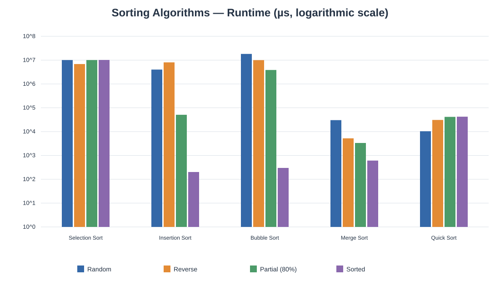

# Sorting Algorithms Benchmark


## بيانات الطالب


- **الاسم:** عبد الرحمن محمد المعتصم دريبيكة
- 
- **الرقم الجامعي:** 3168057
- 
- **المجموعة:** B
- 
- **المقرر:** تراكيب البيانات والخوارزميات — عملي
- 


## وصف المشروع


تطبيق Java يقارن أداء خوارزميات **Selection Sort وInsertion Sort وBubble Sort وMerge Sort وQuick Sort** على مصفوفات من الأعداد الصحيحة بحجم افتراضي **N = 100,000**. يقيس البرنامج زمن الترتيب بالميكروثانية باستخدام `System.nanoTime()`، ويتحقق من صحة ترتيب المصفوفة بعد كل اختبار.


## حالات الاختبار


1. **Random:** أعداد صحيحة عشوائية، باستخدام بذرة ثابتة لإمكانية إعادة التجربة.
2. 
2. **Reverse:** أعداد مرتبة تنازليًا.
3. 
3. **Partial (80%):** أول 80% من المصفوفة مرتبة تصاعديًا، والـ20% الأخيرة تُخلط عشوائيًا.
4. 
4. **Sorted:** أعداد مرتبة تصاعديًا بالكامل.
5. 


تُنسخ بيانات كل حالة قبل القياس، ويُحسب الزمن لعملية الترتيب فقط. تُحوّل قراءة `System.nanoTime()` إلى ميكروثانية بقسمة فرق الزمن على 1,000.


## التعقيد المستخدم


| الخوارزمية | أفضل حالة | متوسط الحالة | أسوأ حالة | مساحة إضافية |

|---|---:|---:|---:|---:|

| Selection Sort | O(N²) | O(N²) | O(N²) | O(1) |

| Insertion Sort | O(N) | O(N²) | O(N²) | O(1) |

| Bubble Sort (مع إيقاف مبكر) | O(N) | O(N²) | O(N²) | O(1) |

| Merge Sort | O(N log N) | O(N log N) | O(N log N) | O(N) |

| Quick Sort (محور وسيط الثلاثة) | O(N log N) | O(N log N) | O(N²) | O(log N) متوقعًا |


## التشغيل


يتطلب المشروع JDK 17 أو أحدث.


```bash

javac -d out src/SortingBenchmark.java

java -cp out SortingBenchmark

```


التشغيل الافتراضي ينفذ جميع الاختبارات المطلوبة على 100,000 عنصر. وللتأكد السريع من عمل البرنامج يمكن تمرير حجم أصغر؛ هذا الخيار للاختبار فقط وليس بدلًا عن تشغيل التكليف بالحجم المطلوب:


```bash

java -cp out SortingBenchmark --n 1000

```


يعرض البرنامج جدول النتائج في الطرفية ويحفظ القياسات في `results.csv` في مجلد التشغيل. قد يستغرق تنفيذ خوارزميات O(N²) وقتًا أطول عند الحجم الكامل.


لإنشاء مخطط SVG من القياسات الفعلية بعد تشغيل البرنامج:


```bash

python3 plot_results.py

```


## النتائج والتحليل


نتائج التشغيل الفعلي عند **N = 100,000**، بوحدة **µs**:


| الخوارزمية | Random | Reverse | Partial (80%) | Sorted |

|---|---:|---:|---:|---:|

| Selection Sort | 10,067,450 | 6,856,882 | 10,072,538 | 10,156,055 |

| Insertion Sort | 4,024,945 | 8,053,711 | 50,884 | 202 |

| Bubble Sort | 18,231,843 | 9,981,927 | 3,863,050 | 299 |

| Merge Sort | 30,268 | 5,216 | 3,344 | 608 |

| Quick Sort | 10,353 | 30,864 | 41,589 | 42,358 |


هذه قراءة واحدة لكل حالة على بيئة Java 21 الافتراضية؛ قد تختلف الأزمنة باختلاف الجهاز وحمل النظام، لذا يُعاد تشغيل البرنامج عند جمع قياسات جهاز آخر. القياسات محفوظة في `results.csv`، والمخطط التالي يعرض المقارنة بمقياس لوغاريتمي:





أظهرت القياسات أن خوارزميتي O(N log N) أسرع بوضوح من خوارزميات O(N²) على البيانات العشوائية. حققت Quick Sort أقل زمن في حالة Random (10,353 µs)، وحققت Merge Sort أقل زمن في حالتي Reverse وPartial (80%) (5,216 و3,344 µs). في حالة Sorted كان Insertion Sort الأسرع (202 µs)، يليه Bubble Sort (299 µs)، بسبب قلة الحركات والتوقف المبكر. بقي Selection Sort قريبًا من 10 ملايين µs حتى على الإدخال المرتب لأنه يمر على بقية العناصر في كل دورة. تُقرأ الفروقات الصغيرة بحذر لأن كل خانة قِيست مرة واحدة فقط.


اختير محور Quick Sort بوسيط أول ووسط وآخر عنصر، ويُستخدم تقسيم ثلاثي للتعامل مع القيم المتساوية. يجري الفرز تكراريًا على الجزء الأصغر ويواصل على الجزء الأكبر لتقليل عمق الاستدعاء. يظل أسوأ تعقيد نظري له O(N²)، لذلك تُفسّر النتائج باعتبارها قياسًا عمليًا لهذه البيانات والمنصة، لا ضمانًا لأفضل أداء في كل إدخال.


## الملفات


- `src/SortingBenchmark.java` — البرنامج وخوارزميات الترتيب والقياس.
- 
- `plot_results.py` — إنشاء مخطط SVG من ملف القياسات دون مكتبات إضافية.
- 
- `results.csv` — القياسات التي ينشئها البرنامج.
- 
- `performance_comparison.svg` — المخطط الذي ينشئه السكربت.


